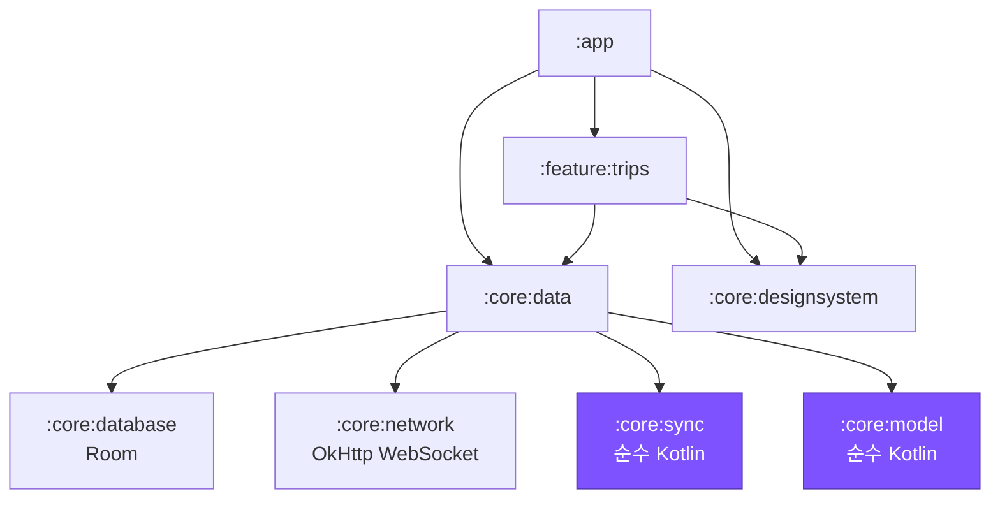
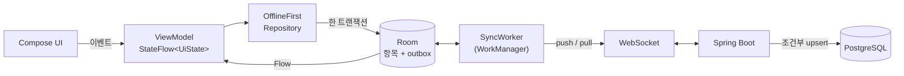

<div align="center">

# ✈️ 트립보드 (TripBoard)

**여럿이 함께 편집하고, 오프라인에서도 쓰는 여행 준비 앱**

비행기 안에서 고친 일정도, 친구가 동시에 바꾼 장소도 — 다시 연결되면 알아서 하나로 합쳐집니다.


</div>

---

## 목차
- [핵심 아이디어](#-핵심-아이디어)
- [기술 스택](#-기술-스택)
- [아키텍처](#-아키텍처)
- [동기화 설계](#-동기화-설계)
- [진행 현황](#-진행-현황)
- [실행 방법](#-실행-방법)
- [문서](#-문서)

## 💡 핵심 아이디어

| | |
|---|---|
| 📴 **오프라인 우선** | 모든 읽기·쓰기는 로컬 Room DB에서. 네트워크는 "나중에 맞춰 주는" 역할만 합니다. |
| 👥 **동시 편집** | 같은 일정을 여러 기기에서 고쳐도 **필드 단위**로 병합해, 서로 다른 필드를 고친 변경은 둘 다 살아남습니다. |
| 🧩 **동기화 엔진 직접 구현** | HLC, LWW 레지스터, OR-Set, 분수 인덱스를 라이브러리 없이 순수 Kotlin으로 작성하고 테스트로 검증합니다. |

## 🛠 기술 스택

| 영역 | 사용 기술 |
|---|---|
| **Android** | Kotlin · Jetpack Compose · Material 3 · Coroutines/Flow · Hilt · Room · WorkManager · Navigation Compose (타입 세이프 라우트) |
| **빌드** | Gradle Kotlin DSL · Version Catalog · `build-logic` 컨벤션 플러그인 · 멀티 모듈 |
| **네트워크** | OkHttp WebSocket (`callbackFlow`로 Flow 변환) · kotlinx.serialization |
| **Server** | Spring Boot 3.5 (Kotlin) · 순수 WebSocket + JSON · JdbcClient · Flyway |
| **DB** | PostgreSQL 16 (docker-compose) |

## 🏗 아키텍처

모노레포 안에 **독립된 Gradle 빌드 두 개**(`android/`, `server/`)가 있습니다.

```
TripBoard/
├── android/            # 앱 (멀티 모듈)
├── server/             # 동기화 서버
├── docs/               # 설계 문서
└── docker-compose.yml  # 로컬 PostgreSQL
```

### Android 모듈 그래프



- `feature`끼리는 서로 모릅니다. 화면 연결은 `app`의 NavHost가 담당합니다.
- `feature`는 `core:data`의 Repository 인터페이스만 봅니다.
- `core:sync`, `core:model`은 **Android 의존성 0** → 에뮬레이터 없이 JVM 단위 테스트로 빠르게 검증합니다.

### 데이터 흐름



## 🔄 동기화 설계

| 구성 요소 | 역할 | 한 줄 설명 |
|---|---|---|
| **HLC** (Hybrid Logical Clock) | 변경 순서 | 물리 시각 + 논리 카운터. 기기 시계가 어긋나도 인과 순서를 지킵니다. |
| **LWW Register** | 필드 값 병합 | 필드마다 `(value, hlc)`를 들고, 더 늦은 HLC가 이깁니다. |
| **OR-Set** | 태그·참여자 같은 집합 | "추가"와 "삭제"가 동시에 일어나도 추가가 사라지지 않습니다. |
| **분수 인덱스** | 일정 순서 | 두 항목 사이에 끼울 문자열 키를 만들어, 순서 변경이 다른 항목을 건드리지 않습니다. |
| **Transactional Outbox** | 로컬 변경 추적 | 항목 수정과 outbox 기록을 한 트랜잭션으로 묶어, 보낼 변경이 유실되지 않습니다. |

서버는 LWW 판정을 SQL 한 문장으로 원자적으로 처리합니다.

```sql
INSERT INTO ... VALUES (...)
ON CONFLICT (...) DO UPDATE SET ...
WHERE target.hlc < EXCLUDED.hlc;
```

pull 커서는 HLC가 아닌 **서버 순번(bigserial)** 을 씁니다. 오프라인이던 기기의 오래된 HLC가 늦게 도착해도 다른 기기가 놓치지 않게 하기 위해서입니다.

> 왜 이렇게 골랐는지(Room vs SQLDelight, STOMP vs 순수 WebSocket, JPA vs JdbcClient 등)는 [docs/architecture.md](docs/architecture.md)의 결정 기록에 정리되어 있습니다.

## 📈 진행 현황

- [x] 멀티 모듈 골격 + `build-logic` 컨벤션 플러그인
- [x] HLC · LWW 구현 + 단위 테스트 (#1, #2)
- [x] 일정 항목 엔티티 / DAO (#3)
- [x] outbox 테이블, 수정 + outbox 트랜잭션, `TripItemRepository` 분리 (#4)
- [x] 원격 변경 LWW 병합 `applyRemoteChange` + 계측 테스트 (#5)
- [ ] 서버 스키마 설계 (`V1__init.sql`) → 조건부 upsert
- [ ] WebSocket push / pull (`SyncSocket` + `SyncWorker`)
- [ ] OR-Set · 분수 인덱스
- [ ] HLC nodeId 영속화 (DataStore)

## 🚀 실행 방법

### 요구 사항
- Android Studio (AGP 8.10 지원 버전 이상), JDK 17+ (Studio 내장 JBR 사용 가능)
- 서버: JDK 21 (없으면 Gradle toolchain이 자동 다운로드), Docker

### 서버
```bash
cd server
./gradlew bootRun          # docker-compose의 Postgres가 자동으로 뜸 (Docker 필요)
```
- 헬스체크: http://localhost:8080/actuator/health
- WebSocket: `ws://localhost:8080/ws/sync` (지금은 에코)

### 앱
Android Studio → **Open** → `TripBoard/android` 폴더 선택 → Gradle Sync → `app` 실행.
목록 화면의 **+** 버튼을 누르면 Room에 여행이 저장되고 목록이 Flow로 갱신됩니다.

### 테스트
```bash
cd android
./gradlew :core:sync:test                          # 동기화 로직 JVM 단위 테스트
./gradlew :core:data:connectedDebugAndroidTest     # Room 계측 테스트 (에뮬레이터 필요)
```

## 📚 문서
- [docs/architecture.md](docs/architecture.md) — 저장소 구조, 모듈 규칙, 예전 방식 ↔ 지금 방식 대응표, 결정 기록

## 🗺 이후 계획
- Flutter 서브 앱
- Kotlin Multiplatform 전환 (`core:sync`를 `commonMain`으로)
- 온디바이스 AI
